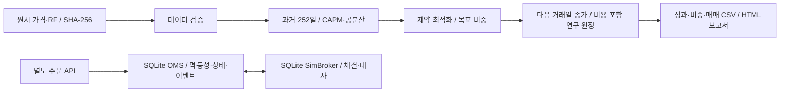

# Daily CAPM Portfolio & OMS Lab

일별 데이터에서 **CAPM으로 기대수익을 추정하고 평균·분산 최적화로 비중을 결정하는 자산배분 백테스트**다. 전략 연구와 주문 관리의 책임을 분리하고, 결과를 데이터·설정·체결 원장까지 추적할 수 있게 만든 Python 프로젝트다.

투자 관점은 개별 차트의 매수·매도 신호보다 **시장 위험, 자산 간 상관관계, 집중도**로 포트폴리오를 관리하는 것이다. 아래 수치와 ETF 목록은 이를 검증하기 위한 첫 실험의 설정이며 특정 투자자에게 적합하다고 검증한 운용 조건은 아니다.

## 먼저 볼 것

- [백테스트 보고서](artifacts/daily-capm/report.html): 성과, 비교 전략, 비용 민감도, 비중 변화
- [실험 설정](configs/daily-capm.json): 기간, 추정 구간, 위험회피계수, 비중 한도, 비용
- [모델과 검증 방식](docs/METHODOLOGY.md): 수식, 시점, 회계, 한계
- [발표·면접 가이드](docs/PRESENTATION.md): 3분 설명과 예상 질문
- [기존 OMS 실습](docs/OMS_TUTORIAL.md): 주문 접수·중복 방지·부분 체결·응답 유실·대사

보고서는 이미 생성되어 있다. 로컬 파일을 브라우저로 열거나 서버 실행 후 [백테스트 화면](http://127.0.0.1:8000/research/)에서 본다. GitHub 파일 보기에서는 HTML이 실행되지 않으므로 내려받거나 로컬 서버를 사용한다.

## 실행과 재현

Python **3.12 이상**. 동봉 결과는 Python 3.14.4에서 검증했다. 아래 명령은 이 README가 있는 프로젝트 디렉터리에서 실행한다.

```bash
python3 -m venv .venv
source .venv/bin/activate
python -m pip install -e '.[dev,research]'

# 네트워크/API 키 없이, 동봉된 실제 데이터 스냅숏으로 재실행
python -m research.run --output artifacts/my-run

# 수식·회계·미래 참조·OMS 검증
python -m pytest -q

# 4개 전략의 모든 거래 CSV를 재생해 일별 자산·비용·보유 비중 대사
python -m research.audit --output evidence/backtest-audit.json

# 독립 임시 DB에서 OMS 시나리오 시연
python -m oms.demo --output evidence/oms-demo.json

# 보고서와 Swagger API
python -m uvicorn oms.api:create_app --factory --host 127.0.0.1 --port 8000
```

[보고서](http://127.0.0.1:8000/research/) · [API 문서](http://127.0.0.1:8000/docs). 동봉 결과를 재생성하려면 `python -m research.run --output artifacts/daily-capm --overwrite`를 쓴다. 비교 실험은 새 출력 경로를 권장한다. 최초 의존성 설치에는 네트워크가 필요하고 이후 백테스트 재현에는 필요 없다.

새 데이터는 별도 빈 디렉터리에 받는다. 제공처의 사후 조정·수정으로 새 다운로드 결과는 기존 스냅숏과 달라질 수 있다.

```bash
python -m research.data --config configs/daily-capm.json --output datasets/new-snapshot
python -m research.run --data datasets/new-snapshot --output artifacts/new-data-run
```

TLS 인증서를 검증하며 오류를 우회하지 않는다. 다운로드가 불가능해도 동봉 스냅숏으로 재현할 수 있다.

## 고정한 기본 실험

| 항목 | 설정 |
| --- | --- |
| 대상 | 미국 섹터 ETF 9개: XLB, XLE, XLF, XLI, XLK, XLP, XLU, XLV, XLY |
| 시장 대용치 / 비교 | SPY |
| 데이터 / 검증 | 2005~2025년 가격 / 2010~2025년 순차 백테스트 |
| 기대수익 | 직전 252거래일의 베타와 시장 초과수익 평균을 이용한 CAPM |
| 공분산 | 직전 252거래일 표본 공분산, 대각 행렬로 10% 축소 + 작은 ridge |
| 최적화 | `max μᵀw − (λ/2) wᵀΣw`, λ=5, 비중 합=1, 0≤w≤25% |
| 리밸런싱 | 매일. t일 종가로 판단, t+1일 종가 체결, 그 다음 구간부터 새 비중 수익 |
| 회계 / 비용 | 초기 $100,000, 분수 조정가격 단위, 매수·매도 거래금액 각각 5bp |
| 비교 전략 | 같은 종목의 일별 동일비중, 일별 최소분산, SPY 매수 후 보유 |

설정은 첫 성과를 보기 전에 고정했다. 수익률에 맞춘 파라미터 탐색은 수행하지 않았다. 전체 자산을 투자하므로 절대적인 손실 제한이나 주식시장 밖으로의 회피 전략은 아니다.

## 기본 실행 결과

| 전략 | CAGR | 최대 낙폭 |
| --- | ---: | ---: |
| CAPM + 평균·분산 | 9.84% | -35.64% |
| 최소분산 | 11.63% | -31.40% |
| 동일비중 | 12.44% | -36.92% |
| SPY 매수 후 보유 | 13.92% | -33.72% |

2010-01-04~2025-12-31, 비용 차감 후, 동봉 스냅숏 기준이다. **이 실험에서 CAPM 전략은 SPY와 동일비중보다 수익률이 낮다.** 낮은 수익률을 숨기거나 초과수익을 입증했다고 표현하지 않는다. 위험조정성과·회전율·기간별 결과는 보고서에서 함께 비교한다.

## 구조



전략 연구 원장은 매수·매도와 자산 평가를 다루며 **기존 OMS의 DB에 주문을 넣지 않는다**. 현재 OMS는 정수 주식 지정가 매수만 지원한다. 연구용 거래와 실제 주식 주문을 연결하는 단계는 남아 있다.

| 코드 | 책임 |
| --- | --- |
| `research/data.py` | TLS 데이터 수집, 원시 응답 보관, 해시·달력·결측 검증 |
| `research/model.py` | CAPM 추정과 제약 최적화, 실패 시 중단 |
| `research/backtest.py` | 신호 지연, 조정수량 원장, 자가금융 비용 계산, 성과 |
| `research/run.py` | 비교 전략, 기간·비용 분석, 보고서·출처 생성 |
| `oms/service.py`, `oms/store.py` | 주문 의도·상태·중복 방지·체결 대사 |
| `tests/test_research.py` | 알려진 해, 미래 데이터 변조, 시점, 비용·평가 회계 |

## 결과 검토와 한계

`artifacts/daily-capm/metrics.json`에 지표가 있다. `signals.csv`는 추정 구간·관측 수·베타·기대수익·목표 비중·체결 예정일을 담는다. 각 전략의 `*_trades.csv`, `*_curve.csv`, `*_weights.csv`로 거래비용과 최종 자산을 대사한다. 수량은 `adjusted_units`이며 실제 주식 수가 아니다.

`run.json`은 설정·환경·코드 해시·데이터 manifest 해시를, `checksums.json`은 산출물 해시를 기록한다. 데이터의 `manifest.json`에는 URL·다운로드 시각·원시 응답·가공 파일 해시가 있다.

현재 ETF 집합의 사후 선택, 데이터 수정, 배당 시점, CAPM 추정 오차, 일별 회전율이 한계다. 조정 종가는 배당·분할 반영 수익률의 대용치이며 당시 체결 호가가 아니다. 다음 종가 분수 단위 전량 체결, 고정 비용, 세금·시장 충격 제외를 명시했다. 생존편향 없는 전체 주식 종목 선택 연구나 실거래 검증으로 해석하지 않는다.

출처: [Yahoo Finance SPY history](https://finance.yahoo.com/quote/SPY/history/), [Kenneth French factors](https://mba.tuck.dartmouth.edu/pages/faculty/ken.french/Data_Library/f-f_factors.html), [SciPy SLSQP](https://docs.scipy.org/doc/scipy/reference/optimize.minimize-slsqp.html).
